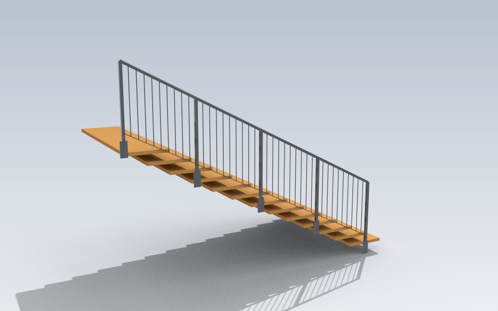
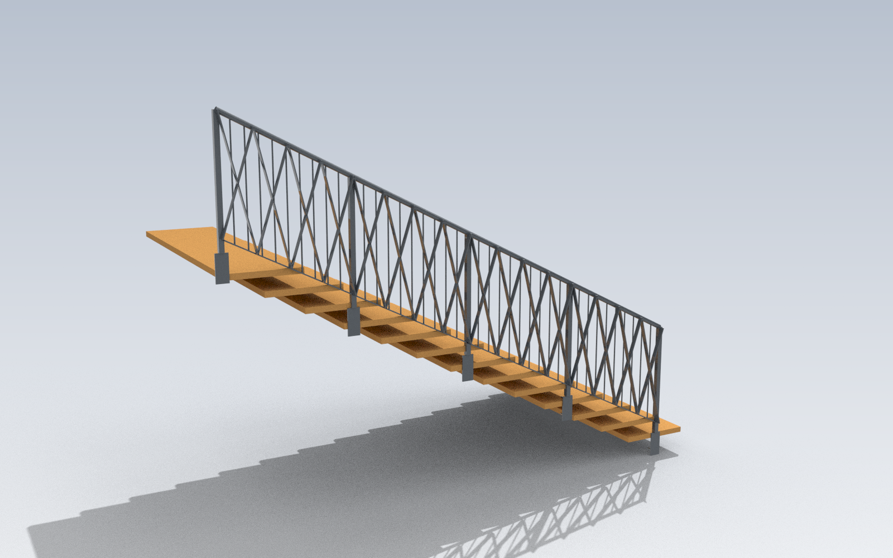
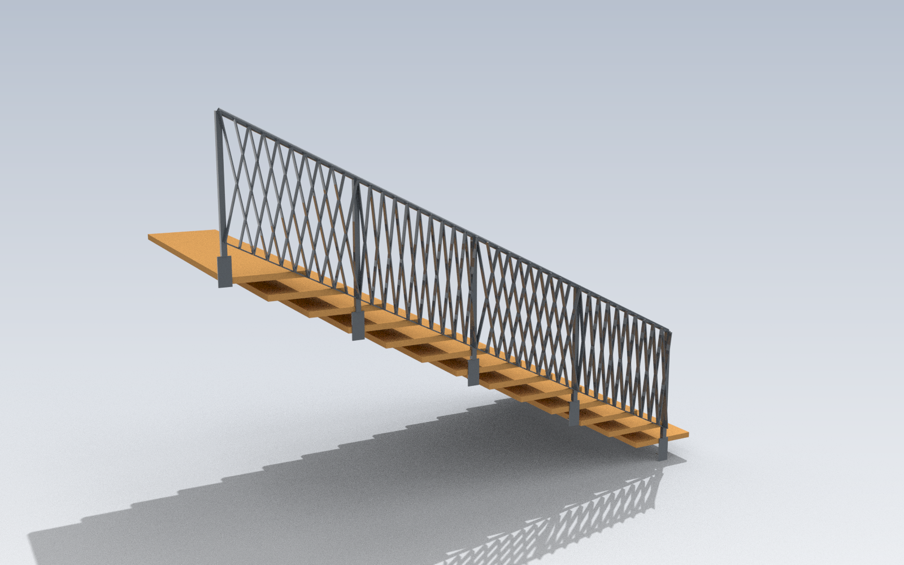

# Stiegengeländer — 3D-Modelle für die Kundenpräsentation

> **Zwei Stände in dieser Datei.** Der Abschnitt
> [Referenzkonfiguration Musterkatalog](#referenzkonfiguration-musterkatalog--gepinnter-vertrag)
> ist der **gültige Vertrag** (Stand 2026-08-05, `Muster`-Regler, 34 Muster).
> Alles ab [Alter Stand](#alter-stand--superseded-fuellung-stil-012) ist **superseded**
> und beschreibt die drei entfernten `Fuellung-Stil`-Varianten.

---

## Referenzkonfiguration Musterkatalog — gepinnter Vertrag

Aufgenommen am **2026-08-05** live aus
`der Live-Definition (`Railing_Generator.gh`)` über den Cordyceps-MCP
(`gh_canvas action=set` auf `Muster`, `gh_document action=recompute`,
`gh_inspect action=outputs` auf die `kg_*`-Komponenten). Es wurde
**ausschließlich der `Muster`-Regler** verändert; alle übrigen Regler standen
auf den unten protokollierten Werten und stehen nach der Aufnahme wieder dort.

### Vollständiger Reglersatz (alle 41 Number Slider)

Reproduzierbarkeit: Diese Tabelle ist vollständig. Wer sie 1:1 einstellt und
`Muster` auf den gewünschten Wert setzt, muss exakt die unten stehenden Massen
erhalten.

#### Muster / Katalog-Engine

| Regler | Wert | GUID |
|---|---|---|
| `Muster` | *variabel — 30 / 23 / 32 / 1 / 11* | `beb0bcaf-41a3-401f-bb28-0b3e42e4a6bd` |
| `Muster-Rapport-Faktor` | 1,00 | `31cb749f-f7df-4bdf-bad3-b8b0d1ce8b5f` |
| `Oeffnung-max` | 120 | `507a7c64-fb95-4429-8190-415cbdd71dbb` |
| `Kletterwinkel-Grenze` | 60 | `385e7c01-a5a1-4bf5-ae4c-04313b289567` |

#### Treppe / Geländer-Grundmaße

| Regler | Wert | GUID |
|---|---|---|
| `Stufenzahl` | 13 | `e8753ff3-517e-4bb9-82cf-4956775aae0e` |
| `Lauf` | 4000 | `8123855f-fd84-44ec-87f0-5ca39624b9b2` |
| `Trittbreite` | 1200 | `bb83017b-4eee-4076-922c-d7e908030c26` |
| `Stufenstaerke` | 24 | `f4c07422-97cd-455f-bf0d-91740a6bb9bc` |
| `Gelaenderhoehe` | 1000 | `0dc23c45-79cd-4c88-ab02-d4a647c7a58b` |
| `Untergurt-Abstand` | 100 | `a77c58f3-0379-43ef-9d2e-04980537e76b` |

Basislinie fest verdrahtet über Panels: Start (0 / 0 / 0), Ende (4000 / 0 / 2000)
→ Lauf 4000 mm, Steigung gesamt 2000 mm. Postenteiler-Panel = 1200 mm ⇒ **5 Posten**.

#### Profilwahl (Index in `grasshopper/profiles.py`)

| Regler | Wert | Profil | kg/m | GUID |
|---|---|---|---|---|
| `Handlauf-Profil` | 3 | SHS 40×40×2,0 | 2,386 | `11c82347-80d8-4998-bd5a-338909f2ba9f` |
| `Posten-Profil` | 2 | SHS 50×50×2,0 | 3,014 | `d309b62d-44b5-444c-9350-365ca2dc7d90` |
| `Fuellstab-Profil` | 3 | Flachstahl 30×5 | 1,178 | `4db1f808-2440-48ab-8db1-e4bb6da5102e` |
| `Diagonal-Profil` | 4 | Flachstahl 40×8 | 2,512 | `c53750d2-3611-4b85-b499-2c89dfc2e3c0` |
| `Untergurt-Profil` | 0 | Flachstahl 40×10 | 3,140 | `d0d6ffc1-6b63-4b24-8b9e-fbbe4635fa43` |

> **Achtung:** Das sind die Werte, wie sie in der gespeicherten Definition stehen —
> **nicht** durchgängig Zeile 0 der jeweiligen Katalogliste. Nur `Untergurt-Profil`
> steht auf dem Katalog-Default 0.

#### Montage (Fascia)

| Regler | Wert | GUID |
|---|---|---|
| `Montage-Typ` | 0 (= Fascia, seitlich) | `5f25fba5-f96d-4ab9-8983-568166f0b7a5` |
| `Platte-Breite` | 240 | `f7cc330e-8233-4e64-99a1-4a379b6ceaa8` |
| `Platte-Hoehe` | 321 | `67171984-131c-41d2-ab63-1de321b8b30c` |
| `Platte-Breite-Top` | 120 | `ca07f98c-c24e-4da5-92d0-29a1f11e8e4d` |
| `Platte-Tiefe` | 120 | `f2e99f66-7b95-4f1d-8392-5d5611ad60db` |
| `Platte-Dicke` | 10 | `c7d160cb-3f19-4058-9cf7-369c26bf6583` |
| `Bolzen-Durchmesser` | 12 | `bae71f08-5a82-4db6-ab8a-c3e4de91595f` |
| `Bolzen-Laenge` | 100 | `d4a30861-158f-4ad6-aeb6-594d3ec0176d` |
| `Bolzen-Offset-V` | 75 | `9d3ce5b7-d37c-4de3-a4a0-15f9d1e9d4f6` |
| `Bolzen-Offset-XY` | 20 | `0b93946e-64de-4474-82b0-25c568629206` |
| `Fascia-Offset` | 0 | `7861978b-3efa-4abf-a60d-0a118b514883` |
| `Bolzen-Masse-kg` | 0,12 | `9e0d89a4-77af-41ac-98fd-5a27d495c265` |

Daraus: 5 Platten à 240 × 321 × 10 mm = 6,04764 kg (ρ = 7,85·10⁻⁶ kg/mm³)
und 10 Bolzen à 0,12 kg.

#### Sondermaterial (Holz / Laserblech)

| Regler | Wert | GUID |
|---|---|---|
| `Holz-Dicke` | 30 | `5af9fee9-59f1-44f4-9457-b2bfc95bc3fc` |
| `Holz-Luft` | 8 | `68f3007d-75bd-4220-897e-f3c3b34bd23e` |
| `Holz-Auslage` | 12 | `7cc735ce-492c-4c68-8a62-2bfb32cedc78` |
| `Holz-Rohdichte` | 600 kg/m³ | `b8fc431c-0f50-4238-b3ab-3085d21ec9c5` |
| `Blech-Dicke` | 4 | `77dd8ef1-e849-4266-8615-1ba49f91222b` |
| `Blech-Steg` | 25 | `a64c61ac-0d5d-46ca-a079-44915464c441` |
| `Blech-Rand` | 30 | `26bca976-eef9-4baa-bf02-4ab9d4d555ef` |
| `Flach-Dicke` | 8 | `aab65510-5e42-45d6-b66e-cdf5cdf7330a` |
| `Vierkant-Breite` | 16 | `bc427056-2ba1-4492-b324-61cdde2f9544` |

Stahl-Solids rechnen fest mit ρ = 7850 kg/m³.

#### Restliche Regler (aus Phase 8, teils ohne Wirkung)

| Regler | Wert | GUID | Anmerkung |
|---|---|---|---|
| `Diagonal-Seed` | **42** | `7ee4f409-a64e-4b18-9c82-51fe7f6e1661` | Seed der Muster-Engine (Eingang `S`) |
| `Diagonal-Dichte` | 300 | `a683ec9a-3dd2-4588-a52f-3bdbc1bd5c66` | **unverdrahtet** (0 Abnehmer), ohne Wirkung |
| `Diagonal-Auslage` | 40 | `acfd7378-1944-464d-89ab-06fe3d38baeb` | Eingang `A` der Muster-Engine |
| `idx0` | 0 | `07d74845-ccc6-4fb7-a4c4-834e7fc91e2d` | Hilfsindex |
| `const2` | 1 | `34732919-289e-4286-b5c7-6fd813092776` | Hilfskonstante |

> `pfostenMittig: false` ist **kein Grasshopper-Regler**. Der Schalter existiert nur
> in der Web-App (`web/model.js`, `web/main.js`). Die GH-Definition verteilt die
> Posten immer gleichmäßig über `Divide Curve` (Panel 1200 mm), rastet also nie auf
> Stufenmitten — das entspricht genau `pfostenMittig: false`.

### Massen je Muster (kg)

Alle Werte direkt aus den `kg_*`-Komponenten abgelesen, ohne Nachrundung.
Der Zustand wurde vor jedem Ablesen über den `Info`-Ausgang der Muster-Engine
verifiziert (`Muster NN <Name>`), nicht nur über „keine Fehler".

| Position | Komponente | 30 bar-vertical | 23 bar-scatter | 32 rake-uniform | 01 panel-stagger | 11 sheet-ellipse |
|---|---|---:|---:|---:|---:|---:|
| Füllstäbe (Füllprofil) | `kg_Fuell` | 42,408000 | 46,648800 | 61,371878 | 0,000000 | 0,000000 |
| Handlauf | `kg_Hand` | 10,670516 | 10,670516 | 10,670516 | 10,670516 | 10,670516 |
| Posten | `kg_Post` | 15,070000 | 15,070000 | 15,070000 | 15,070000 | 15,070000 |
| Untergurt | `kg_Unter` | 14,042507 | 14,042507 | 14,042507 | 14,042507 | 14,042507 |
| **Zwischensumme Rahmen** | **`kg_GESAMT`** | **82,191023** | **86,431823** | **101,154901** | **39,783023** | **39,783023** |
| Zweites Profil / Diagonalen | `kg_Diag` | 0,000000 | 28,631227 | 0,000000 | 22,468011 | 0,000000 |
| Ankerplatten (5 St.) | `kg_Platten` | 30,238200 | 30,238200 | 30,238200 | 30,238200 | 30,238200 |
| Bolzen M12 (10 St.) | `kg_Bolzen` | 1,200000 | 1,200000 | 1,200000 | 1,200000 | 1,200000 |
| **Summe Stahlbau** | **`kg_GESAMT_ALL`** | **113,629223** | **146,501250** | **132,593101** | **93,689234** | **71,221223** |
| Stahl-Solids (Laserblech) | `kg_Stahl` | 0,000000 | 0,000000 | 0,000000 | 0,000000 | 73,016554 |
| Holz-Solids | `kg_Holz` | 0,000000 | 0,000000 | 0,000000 | 27,584006 | 0,000000 |
| **Gesamt inkl. Sondermaterial** | **`kg_GESAMT_MAT`** | **113,629223** | **146,501250** | **132,593101** | **121,273240** | **144,237777** |

Stückzahlen laut `Info`-Ausgang bei dieser Konfiguration:

| Muster | Stäbe (Füllprofil) | Stäbe (2. Profil) | Stahl-Solids | Holz-Solids | Rapport |
|---|---:|---:|---:|---:|---:|
| 30 bar-vertical „Vertical Bars" (Lines) | 40 | 0 | 0 | 0 | 110 mm |
| 23 bar-scatter „Scattered Diagonals" (Rhythm) | 44 | 12 | 0 | 0 | 100 mm |
| 32 rake-uniform „Uniform Rake" (Lines) | 60 | 0 | 0 | 0 | 80 mm |
| 01 panel-stagger „Staggered Panels" (Formed) | 0 | 8 | 0 | 44 | 100 mm |
| 11 sheet-ellipse „Ellipse Sheet" (Organic) | 0 | 0 | 4 | 0 | 140 mm |

### Summenkontrolle

Die drei Additionsketten in der Definition lauten:

1. `kg_Fuell + kg_Hand + kg_Post + kg_Unter = kg_GESAMT`
2. `kg_GESAMT + kg_Diag + kg_Platten + kg_Bolzen = kg_GESAMT_ALL`
3. `kg_GESAMT_ALL + kg_Stahl + kg_Holz = kg_GESAMT_MAT`

Alle drei stimmen für alle fünf Muster **auf die letzte abgelesene Stelle**
(Residuum exakt 0,000000; Toleranz 1·10⁻⁵ kg). Die Toleranz ergibt sich aus der
Anzeigegenauigkeit von 6 Nachkommastellen: pro Summand höchstens 5·10⁻⁷ kg
Rundungsfehler, bei bis zu 5 Termen also ≤ 2,5·10⁻⁶ kg — 1·10⁻⁵ kg liegt sicher
darüber und weit unter jedem echten Stücklistenfehler (der in `0adcbda`
behobene Defekt lag im Kilogramm-Bereich).

### Null-Identitäts-Falle

Nicht benutzte Materialkanäle liefern **echte Nullen**, keine „1 m³"-Geister:

* `kg_Holz` = 0 bei allen Mustern ohne Holz (30, 23, 32, 11) ✔
* `kg_Stahl` = 0 bei allen Mustern ohne Laserblech (30, 23, 32, 01) ✔
* `kg_Diag` = 0 bei allen Mustern ohne zweites Profil (30, 32, 11) ✔

Die Nullwächter (Panel „0" → `Merge` → `Flatten Tree` → `Mass Addition`)
vor jeder `Mass Addition` funktionieren.

---

## Alter Stand — SUPERSEDED (`Fuellung-Stil` 0/1/2)

> **⚠ Superseded durch Phase 14 — Zahlen unten NICHT mehr als Vertrag verwenden.**
> `Fuellung-Stil` 0/1/2 existiert in der Grasshopper-Definition nicht mehr; der
> `Muster`-Regler (0–33) hat ihn ersetzt.
>
> **Die Dateinamen dieses Exports sind auf die heutigen Muster-Keys umbenannt** —
> das ist eine Zuordnung nach dem Augenschein, **kein bitgleicher Neubau**. Die
> Dateien stammen vom 2026-07-26 und sind **älter als die 34-Muster-Engine**;
> sie wurden nicht neu gerechnet. Die jeweils nächstliegende Entsprechung ist:
>
> | Datei (neu) | alter Stil | nächstliegendes Muster heute |
> |---|---|---|
> | `railing_bar-vertical` | 0 — nur Vertikalstäbe | 30 `bar-vertical` „Vertical Bars" |
> | `railing_bar-scatter` | 1 — Vertikalfeld + Diagonalen | 23 `bar-scatter` „Scattered Diagonals" |
> | `railing_rake-uniform` | 2 — nur Diagonalen | 32 `rake-uniform` „Uniform Rake" |
>
> Die Massen sind **nicht** übertragbar: der Export lief mit anderen Profilindizes
> und einer anderen Ankerplatte (100 × 220 × 10 statt 240 × 321 × 10). Deshalb liegt
> der alte Stil 0 bei 77,49 kg, `bar-vertical` (30) heute dagegen bei 113,63 kg.
> Der Abschnitt bleibt als Historie stehen; gültig ist der Vertrag oben.
> Die `.3dm`/`.stp`/`.obj`-Dateien dieses Exports zeigen ebenfalls den alten Stand.

Exportiert aus `Railing_Generator.gh` am 2026-07-26 mit
`grasshopper/export_models.py`. Drei Füllungsvarianten, jeweils in drei Formaten.
Das Skript exportiert inzwischen nach `Muster`-Index (0–33) und schreibt
`Stiegengelaender_Muster<NN>_<key>.*`; die drei Dateien unten lassen sich damit
**nicht** mehr reproduzieren.

### Ansichten

Je ein Render pro Exportdatei:

| `railing_bar-vertical` | `railing_bar-scatter` | `railing_rake-uniform` |
|---|---|---|
|  |  |  |

| Render | gehört zu | zeigt |
|---|---|---|
| `render_bar-vertical.png` | `railing_bar-vertical.{stp,obj,mtl}` | nur Vertikalstäbe |
| `render_bar-scatter.png` | `railing_bar-scatter.{stp,obj,mtl}` | Vertikalfeld + dekorative Diagonalen |
| `render_rake-uniform.png` | `railing_rake-uniform.{stp,obj,mtl}` | nur Diagonalen |

### Varianten

| Datei | Füllung | Stahlteile | Masse gesamt |
|---|---|---|---|
| `railing_bar-vertical` | nur Vertikalstäbe | 63 | 77,49 kg *(superseded)* |
| `railing_bar-scatter` | Vertikalfeld + dekorative Diagonalen | 95 | 152,62 kg *(superseded)* |
| `railing_rake-uniform` | nur Diagonalen | 98 | 219,11 kg *(superseded)* |

Massenaufstellung je Variante (kg) — **superseded**:

| Position | `bar-vertical` | `bar-scatter` | `rake-uniform` |
|---|---|---|---|
| Handlauf Ø42,4×2,0 | 8,91 | 8,91 | 8,91 |
| Untergurt Flachstahl 40×10 | 14,04 | 14,04 | 14,04 |
| Posten SHS 40×40×2,0 | 11,93 | 11,93 | 11,93 |
| Füllstäbe Ø12 | 32,77 | 32,77 | 0,00 |
| Diagonalen Flachstahl 40×8 | 0,00 | 75,13 | 174,39 |
| Ankerplatten | 8,64 | 8,64 | 8,64 |
| Bolzen M12 | 1,20 | 1,20 | 1,20 |
| **Gesamt** | **77,49** | **152,62** | **219,11** |

### Formate

* `.3dm` — Rhino 8, nach Layern getrennt (`Stahl`, `Treppe`), mit Materialien.
* `.stp` — STEP, Volumenkörper, für jedes CAD-System.
* `.obj` (+ `.mtl`) — Mesh, für Viewer und Web.

Einheit ist **Millimeter**, Ursprung am Fußpunkt der Treppenbasislinie.

### Gebaute Konfiguration (Stand 2026-07-26, superseded)

Lauf 4000 mm, Steigung gesamt 2000 mm, 13 Stufen (307,7 × 153,8 mm),
Trittbreite 1200 mm, Stufenstärke 24 mm.
Geländerhöhe 1000 mm über Vorderkante Stufe (OIB RL 4 / ÖNORM B 5371),
Untergurt 100 mm darüber, Füllstababstand 115 mm (lichter Spalt 103 mm,
Anforderung ≤ 120 mm). Montage seitlich (Fascia), Platte 100 × 220 × 10 mm
mit 2 × M12 je Posten, 5 Posten.

## Gerenderte Ansichten der 34 Muster — nur lokal, nicht im Repo

`grasshopper/render_muster.py` erzeugt `reference/renders_muster/m00_…png` … `m33_…png`
(raytraced, feste Dreiviertelansicht, Treppe sichtbar) — je ein Bild pro Muster.

**Der Ordner ist gitignored.** Wer ihn hier nicht findet, hat nichts kaputt
gemacht: die Dateien liegen ausschließlich auf der Maschine, die sie gerendert
hat, und ein frischer Clone kann sie **nicht** nachbauen, weil dazu Rhino mit
der geöffneten Definition und der Cordyceps-Brücke nötig ist. Umdrehen lässt
sich das mit einer Zeile in `.gitignore`.

Diese Bilder sind **Sicht- und Präsentationsmaterial, kein Nachweis**. Sie
zeigen, ob Geometrie da ist und wie sie aussieht — nicht, ob ein Element
tatsächlich angeschlossen ist. Das prüft der `_free_ends`-Riegel der Engine.

## Hinweise für die Fertigung

* Die 10 Bolzen sind offene Zylinderflächen (Lagesymbol, kein Gewinde) und
  erscheinen im STEP daher nicht als Volumenkörper.
* Es ist **keine Wange und keine Decke modelliert**; die Ankerplatten hängen
  frei an der Treppenkante. Für die Werkplanung muss der Befestigungsuntergrund
  ergänzt werden.
* `Diagonal-Dichte` (Knotenabstand der Diagonalen, 50–400 mm) steht auf 300 mm.
  **Superseded:** der Regler hat seit Phase 14 keinen Abnehmer mehr und damit
  keine Wirkung; die Dichte ergibt sich jetzt aus dem Muster-Rapport und
  `Oeffnung-max`.
